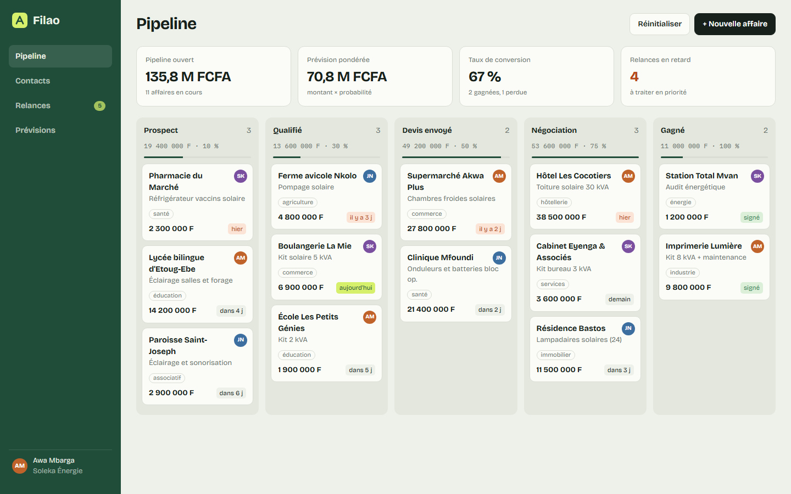
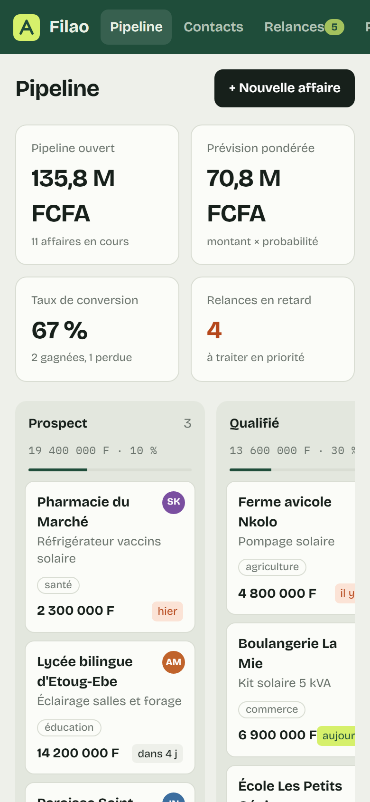

# Filao

**CRM et pipeline commercial** — CRM pour une PME qui vend des installations solaires : pipeline des ventes en colonnes avec glisser-déposer, fiche détaillée de chaque affaire avec historique des échanges, relances classées par urgence, annuaire des contacts et prévisions de chiffre d'affaires pondérées par la probabilité de signature.

**Démo en ligne : [https://lordlennyx.github.io/filao-crm/](https://lordlennyx.github.io/filao-crm/)**

Spot de présentation (30 s) : [media/spot-30s.mp4](https://lordlennyx.github.io/filao-crm/media/spot-30s.mp4)

## Ce que le projet montre

- Pipeline en 5 étapes avec glisser-déposer, totaux et probabilités par colonne
- Indicateurs en direct : pipeline ouvert, prévision pondérée, taux de conversion, relances en retard
- Fiche affaire : étapes cliquables, compte rendu d'appel, de visite ou d'e-mail, relance planifiée, gagnée ou perdue
- Relances regroupées (en retard, aujourd'hui, cette semaine) et cochables
- Contacts : recherche sans accents, tri par colonne
- Prévisions mensuelles : signé, pondéré, potentiel, avec tableau de données
- Création d'affaire, données conservées dans le navigateur, réinitialisation

## Réalisation

- **Stack :** HTML, CSS, JavaScript natif, SVG
- **Typographies :** Bricolage Grotesque, IBM Plex Mono
- **Évolutions possibles :** comptes utilisateurs et base de données (Supabase, PostgreSQL), synchronisation e-mail et WhatsApp, import CSV

| Bureau | Mobile |
|---|---|
|  |  |

---

Client et contenus fictifs, créés pour la démonstration. Conception, design et développement : **Njundiyimun Béchard** — [github.com/LordLennyx](https://github.com/LordLennyx)
